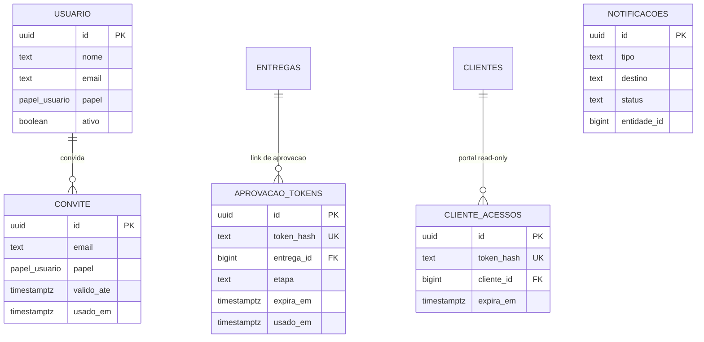

# PlanHub — Planejamento e entregas

Case técnico para a vaga de **Analista de BI Pleno (AI Builder)** na Conversion.
O objetivo é tirar o controle de entregas de uma planilha e transformá-lo em um
app de verdade: diagnóstico dos dados, modelo em estrela e uma fatia funcional
completa.

**App no ar:** https://planhub-co.vercel.app/login
**README de produto:** [`docs/readme_produto.md`](docs/readme_produto.md) (também
em `/sobre` no app).

**Estado atual:** Fases 0 a 4 concluídas. Falta gravar o vídeo de demonstração.

## Fases

| Fase | Entrega | Estado |
| :--- | :--- | :--- |
| 0 | Estrutura do projeto, stack, decisões e ambiente | Concluída |
| 1 | Diagnóstico dos dados e base normalizada | Concluída |
| 2 | Modelagem Postgres/Supabase (estrela), RLS e importação | Concluída |
| 3 | Fatia funcional do app | Concluída |
| 4 | README de produto (1 página) | Concluída |
| 5 | Vídeo de demonstração (5–10 min) | A fazer |

## Diagnóstico em números

Base: `dados/controle_entregas.csv`, 1.007 linhas, nov/2025 a out/2026.

| Indicador | Valor |
| :--- | ---: |
| Clientes após normalização | 25 (eram 31 grafias) |
| Entregas com prazo e data de entrega | 888 |
| Entregas após o prazo | 273 (**30,7%**) |
| Mediana do atraso | 6 dias |
| Entregas abertas com prazo vencido hoje | 71 |
| IDs repetidos | 12 (24 linhas) |
| Linhas com assinatura idêntica (fantasmas) | 38 |
| Ocorrências na fila de revisão | 302 (121 críticas) · 47 linhas |

O diagnóstico completo está no notebook [`docs/diagnostico.ipynb`](docs/diagnostico.ipynb) e as
decisões em [`docs/decisoes.md`](docs/decisoes.md).

## O app

| Rota | O que faz |
| :--- | :--- |
| `/login` | Porta de entrada. Acesso por convite, sem cadastro público |
| `/login/esqueci-senha` | Recuperação de senha por link (1 hora) |
| `/login/nova-senha` | Definição da senha nova após o link |
| `/conta` | Segurança da conta: verificação em duas etapas (TOTP) |
| `/inicio` | Indicadores (atraso, vencidas, aguardando cliente, fila de revisão) |
| `/entregas` | Lista com busca, filtros (cliente, fase, tipo, atraso) e paginação |
| `/entregas/nova` | Cadastro de entrega com validação |
| `/entregas/[id]` | Detalhe: situação, aprovação em 2 etapas, histórico e aprovações |
| `/clientes` | Clientes canônicos e grafias da planilha |
| `/revisao` | Fila de revisão da importação, com resolver/reabrir |
| `/equipe` | Pessoas, papéis e convites (admin) |
| `/aprovacao/[token]` | Página pública do cliente, sem login |
| `/cliente/[token]` | Portal read-only do cliente: acompanhamento e aprovações pendentes |
| `/sobre` | README de produto |

## Como rodar

Requisitos: Node.js 20.9+ (testado com Node 26 e Next 16) e Python 3.10+.

```bash
# 1. dependências
npm install

# 2. diagnóstico (gera analysis/out/* e o relatório interno)
npm run diagnostico

# 3. testes do normalizador
npm run test:diagnostico

# 4. app
npm run dev
```

O app abre em `http://localhost:3000`.

### Estado de demonstração

Três entregas do cliente **Escola Saber Mais** cobrem os estados que a
apresentação mostra: aguardando o planejamento do cliente, aguardando a
aprovação da entrega e em produção com prazo vencido.

```bash
npm run demo:estado             # recria o estado e emite links de aprovação novos
npm run demo:estado -- --status # mostra o estado atual
```

O comando mexe só nas entregas marcadas como demonstração (`origem_linha->>'demo'`),
e aprovar pelo link consome o token — por isso existe o reset.

### Banco de dados (Supabase)

As migrations em `supabase/migrations/` criam o modelo estrela do zero. Para
reproduzir a base em outro projeto:

```bash
# requer a senha do banco (DB_PASSWORD) ou DATABASE_URL
node scripts/importar-para-supabase.mjs
```

A conexão usa o pooler do Supabase (`*.pooler.supabase.com`, IPv4): o host
direto `db.<ref>.supabase.co` resolve apenas IPv6 e não conecta em redes IPv4.

### Variáveis de ambiente

Copie `.env.example` para `.env.local` e preencha com um projeto Supabase
**criado para este case**. Nunca use credenciais pessoais. Nenhum `.env*` é
versionado.

## Modelo de dados

Modelo em estrela no Postgres/Supabase: três fatos, dez dimensões e dois
esquemas de acesso. O app lê apenas as visões (`security_invoker`); a regra de
negócio vive no banco, não no cliente.

### Estrela


### Acesso, convites e tokens



`PK` chave primária · `FK` chave estrangeira · `UK` única. `aprovacao_priv`
não é exposto pela Data API: as duas tabelas de token guardam apenas
`sha256(token)`, com expiração e uso único, e só são lidas por funções
`SECURITY DEFINER`.

## Estrutura

```
app/                    App Next.js (App Router)
  (app)/                Rotas internas com menu lateral
  aprovacao/[token]/    Página pública do cliente
  login/                Porta de entrada
  sobre/                README de produto
lib/                    Clientes Supabase, consultas e validação
proxy.ts                Guarda de login e usuário ativo
analysis/
  diagnostico.py        Script de diagnóstico e normalização
  test_diagnostico.py   Testes do normalizador
  out/                  Saídas geradas: base normalizada, erros, métricas
supabase/
  migrations/           Modelo estrela, RLS, funções e carga
docs/
  diagnostico.ipynb     Diagnóstico em notebook (executado)
  decisoes.md           Decisões, premissas e alternativas descartadas
  acesso_cliente.md     Por que link e não conta de cliente (apoio à apresentação)
  acesso_avaliador.md   Como testar: perfis, portal, demo e rodar local
  readme_produto.md     README de produto (1 página)
  plano_melhoria.md     Plano de melhoria que guiou a fatia funcional
dados/                  Base original do case
scripts/                Importação, deploy, contas de teste e estado de demonstração
```

## Decisões principais

- **Fase e aprovação são dimensões separadas.** O `status` da planilha não
  respondia "onde está a entrega".
- **Nada é apagado em silêncio.** Duplicados e inconsistências vão para a fila
  de revisão, e a linha original fica preservada.
- **Cliente aprova por link com token**, sem login, expondo apenas aquela entrega.
  E-mail obrigatório, origem (IP) registrada e link novo invalidando o anterior;
  o portal lista e abre as aprovações que o time colocou em aprovação. Ver
  `docs/acesso_cliente.md`.
- **Atraso tem definição única**, documentada, usada pelo diagnóstico e pelo app.
- **Modelo em estrela**: fatos (`entregas`, `eventos_entrega`, `aprovacoes`) e
  dimensões (`clientes`, `fases`, `calendario`…), com RLS por papel.

## Uso de IA

### Ferramentas

| Ferramenta | Onde entrou |
| :--- | :--- |
| **OpenCode** (agente de código) | Estrutura do projeto, as 24 migrations, o app Next.js, os testes e a documentação |
| **MCP do Supabase** (`mcp.supabase.com`) | Schema, migrations, dados e logs do projeto durante a modelagem e a depuração |
| **MCP do Vercel** (`mcp.vercel.com`) | Deploy, domínio `planhub-co.vercel.app` e variáveis de ambiente |
| **Plugin `opencode-supabase`** | Integração do agente com o projeto Supabase |
| **Skills `supabase` e `impeccable`** | Convenções de Postgres/RLS e o redesenho visual (login, dashboard, modo escuro) |
| **`AGENTS.md`** | Contrato de trabalho do agente: stack, convenções, regras de banco e segurança |

O agente trabalhou direto no repositório, seguindo o `AGENTS.md`, e consolidou
cada etapa em migration incremental — nenhuma migration já aplicada foi editada.

### Modelos

| Modelo | Provider |
| :--- | :--- |
| `baidu/ernie-5.5-flash-preview:free` | OpenRouter |
| `z-ai/glm-5.3-flash` | OpenRouter |
| `deepseek/deepseek-v4.1-flash-1017` | OpenRouter |
| `anthropic/claude-haiku-5.5` | OpenRouter |
| `nvidia/nemotron-3.5-lightning:free` | OpenRouter |
| `nemotron-3.5-super-vl-free` | OpenCode |
| `deepseek-v4.1-flash-free` | OpenCode |

Foram alternados ao longo das sessões, conforme a tarefa — o agente, o modelo e
a variante ficam registrados por sessão no próprio OpenCode.

### O que ficou fora do agente

O normalizador em `analysis/diagnostico.py` e os testes em
`analysis/test_diagnostico.py` são scripts próprios em Python; nenhuma decisão
de negócio foi delegada. Pontos revisados manualmente: inferência de ano em datas
abreviadas, tratamento de revisões inválidas (`99`, `-1`, "duas") e a decisão de
não apagar duplicados. Um teste encontrou um bug real no normalizador (um `-1`
virava `1`), corrigido antes de gerar a base final.

## Premissas

- Dados fictícios, com inconsistências intencionais, tratadas como sujeira real.
- Datas em nov/2026 ficam fora da janela declarada e são mantidas com sinalização.
- "ok" em status sem aprovação registrada é tratado como entregue, com flag.
- Em relatório, aprovação de planejamento vazia é "não se aplica".
- A data de referência de "atraso hoje" é a data de execução.
- O provedor de e-mail está em modo de teste (domínio não verificado): só entrega
  ao e-mail da conta Resend. A falha aparece na tela com o motivo, e o link de
  aprovação continua visível para copiar e enviar pelo canal de contato.