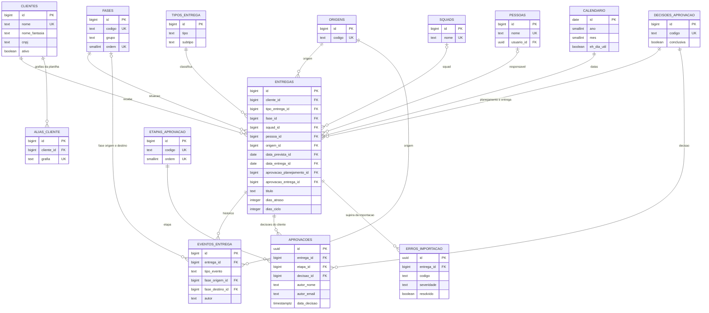
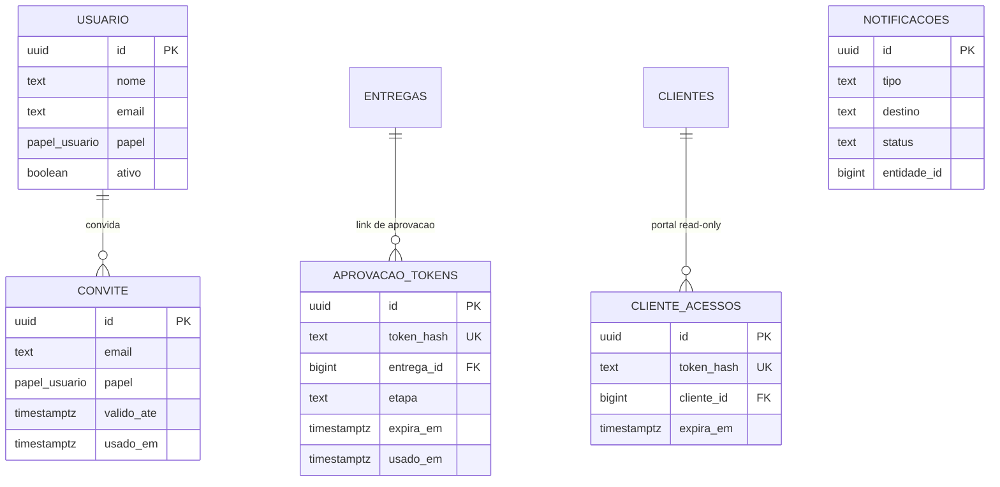

# PlanHub — Planejamento e entregas

O controle de entregas de uma operação de SEO saiu da planilha e virou um app:
diagnóstico dos dados, modelo em estrela no Postgres e uma fatia funcional com
aprovação do cliente por link, sem login.

**App publicado:** https://planhub-co.vercel.app/login
**README de produto (1 página):** [`docs/readme_produto.md`](docs/readme_produto.md)

Case técnico — Analista de BI Pleno (AI Builder) · Conversion · novembro/2026.
Dados fictícios, criados para o case.

## Sumário do repositório

| Pasta | O que tem |
| :--- | :--- |
| `app/` | App Next.js (App Router): rotas internas, login, aprovação do cliente e portal read-only |
| `lib/` | Clientes Supabase, consultas às visões, validação Zod, e-mail e rótulos de tela |
| `supabase/` | 39 migrations: modelo estrela, RLS, funções, carga, tokens e filas |
| `analysis/` | Diagnóstico em Python, testes do normalizador e saídas geradas |
| `docs/` | Diagnóstico, decisões, acesso do cliente, README de produto e evidências de teste |
| `scripts/` | Importação, deploy, contas de teste e reset do estado de demonstração |
| `dados/` | Base original do case (CSV) |
| `public/` | Cópias geradas dos artefatos do diagnóstico, servidas pelo app |
| `.opencode/` | Configuração do agente de código (plugin Supabase) |

Na raiz ficam o `README.md`, o `AGENTS.md` (contrato do agente), o `DESIGN.md`
(tokens visuais), o `proxy.ts` (guarda de sessão) e os arquivos de configuração
(`package.json`, `next.config.ts`, `tsconfig.json`, `vercel.json`).

## Entregáveis

| # | Entregável | Onde está |
| :--- | :--- | :--- |
| 1 | Diagnóstico dos dados | Notebook executado em [`docs/diagnostico.ipynb`](docs/diagnostico.ipynb) · saídas em `analysis/out/` · resumo abaixo |
| 2 | Modelagem Postgres | 39 migrations em [`supabase/migrations/`](supabase/migrations) · diagrama ER abaixo |
| 3 | Fatia funcional do app | App publicado · rotas e roteiro de teste abaixo · evidências em [`docs/testes/`](docs/testes) |
| 4 | README de produto (até 1 página) | [`docs/readme_produto.md`](docs/readme_produto.md) |
| — | Vídeo de demonstração (5–10 min) | Entregue à parte, fora do repositório |

## Como testar

1. Abra https://planhub-co.vercel.app/login.
2. Entre com um dos perfis abaixo. As senhas e os links do cliente vão no e-mail
   de entrega, não neste repositório.
3. Siga o roteiro de 5 minutos.

| Perfil | E-mail | O que pode fazer |
| :--- | :--- | :--- |
| Admin | `admin@planhub.case` | Tudo: entregas, clientes, equipe, convites, revisão e links |
| Gestor | `gestor@planhub.case` | Entregas, clientes, links de aprovação e avisos; não mexe em equipe |
| Operador | `operador@planhub.case` | Cadastra e edita entregas; não gera links nem administra |
| Leitor | `leitor@planhub.case` | Só consulta — a RLS bloqueia a escrita |

**Roteiro sugerido:**

| Passo | Onde | O que observar |
| :--- | :--- | :--- |
| 1 | `/inicio` | Indicadores de atraso, vencidas, aguardando cliente e fila de revisão |
| 2 | `/entregas` | Busca, filtros (cliente, fase, tipo, atraso), ordenação por coluna, paginação e exportação CSV |
| 3 | `/entregas/nova` | Cadastro com validação; grave e veja a entrega na lista |
| 4 | `/entregas/[id]` | Situação, aprovação em duas etapas, histórico e aprovações registradas |
| 5 | `/revisao` | Fila da importação: resolver e reabrir com o motivo |
| 6 | `/clientes` | Clientes canônicos e as grafias originais da planilha |
| 7 | `/equipe` | Papéis e convites (admin) |
| 8 | Link do e-mail | Aprovação do cliente: nome, e-mail, observação e origem registrados |

O cliente **não tem conta**: recebe um link de uso único por etapa, com validade,
e um portal read-only com as entregas dele e as aprovações pendentes. Ao gerar o
link do portal em `/clientes`, o app envia-o por e-mail ao cliente quando ele
tem endereço cadastrado — a caixa com o link continua visível para copiar em
qualquer caso. A geração de um link novo revoga o anterior.

### Estado de demonstração

Três entregas do cliente **Escola Saber Mais** cobrem os estados da apresentação:
aguardando o planejamento do cliente, aguardando a aprovação da entrega e em
produção com prazo vencido.

```bash
npm run demo:estado             # recria o estado e emite links de aprovação novos
npm run demo:estado -- --status # mostra o estado atual
```

O comando mexe só nas entregas marcadas como demonstração (`origem_linha->>'demo'`).
Aprovar pelo link consome o token — por isso existe o reset.

## Diagnóstico

Base: `dados/controle_entregas.csv`, 1.007 linhas, nov/2025 a out/2026.
Após a deduplicação (10 IDs repetidos + 11 links repetidos de reimportação),
o banco fica com 986 entregas importadas (mais 3 de demonstração).

| Indicador | Valor |
| :--- | ---: |
| Clientes após normalização | 25 (eram 31 grafias) |
| Entregas com prazo e data de entrega | 888 |
| Entregas após o prazo | 273 (**30,7%**) |
| Mediana do atraso | 6 dias (P90: 21) |
| Entregas abertas com prazo vencido hoje | 71 |
| IDs repetidos | 12 (24 linhas) |
| Linhas com assinatura idêntica (fantasmas) | 38 |
| Ocorrências na fila de revisão | 302 (121 críticas) · 47 linhas |

O que o diagnóstico mostrou:

- **O atraso é estrutural, não pontual.** 30,7% das 888 entregas comparáveis
  passaram do prazo; Conteúdo tem a maior taxa (41,1%), seguido de Análise
  (32,9%) e Relatório (15,9%).
- **A planilha não respondia "onde está a entrega".** Os 22 valores de `status`
  misturavam produção, espera e aprovação — a separação em fase e aprovação
  nasceu daí.
- **A sujeira é real e precisa ficar visível.** Datas em quatro formatos,
  duplicados, revisões inválidas (`99`, `-1`, "duas") e 38 linhas-fantasma.
  Nada foi apagado: tudo vai para a fila de revisão com a linha original
  preservada.

Detalhe completo: [`docs/diagnostico.ipynb`](docs/diagnostico.ipynb),
`analysis/out/relatorio_diagnostico.md` e as decisões em
[`docs/decisoes.md`](docs/decisoes.md).

## Modelo de dados

Modelo em estrela no Postgres/Supabase: **3 fatos** (`entregas`,
`eventos_entrega`, `aprovacoes`), **10 dimensões** (`clientes`, `fases`,
`tipos_entrega`, `squads`, `pessoas`, `origens`, `calendario`,
`decisoes_aprovacao`, `etapas_aprovacao`, `aliases_cliente`) e **2 tabelas de
token** no schema privado `aprovacao_priv`, que a Data API não expõe.

O app não consulta tabela base: lê as visões `entregas_detalhadas`,
`indicadores_mensais` e `eventos_detalhados`, todas com `security_invoker`.
A regra de negócio vive no banco, com RLS por papel em toda tabela.

### Estrela





`PK` chave primária · `FK` chave estrangeira · `UK` única. As duas tabelas de
token guardam apenas `sha256(token)`, com expiração e uso único, e só são lidas
por funções `SECURITY DEFINER`.

## O app

| Rota | O que faz |
| :--- | :--- |
| `/login` | Porta de entrada. Acesso por convite, sem cadastro público |
| `/login/esqueci-senha` | Recuperação de senha por link (1 hora) |
| `/login/nova-senha` | Definição da senha nova após o link |
| `/conta` | Segurança da conta: verificação em duas etapas (TOTP) |
| `/inicio` | Indicadores (atraso, vencidas, aguardando cliente, fila de revisão) |
| `/entregas` | Lista com busca, filtros (cliente, fase, tipo, atraso, planejamento), ordenação por coluna, paginação e exportação CSV |
| `/entregas/nova` | Cadastro de entrega com validação |
| `/entregas/[id]` | Detalhe: situação, aprovação em 2 etapas, histórico e aprovações |
| `/entregas/[id]/editar` | Edição da entrega — prazo, revisões, link, observações, squad e responsável (admin/gestor) |
| `/clientes` | Clientes canônicos e grafias da planilha |
| `/revisao` | Fila de revisão da importação (resolver/reabrir), encerramento de entregas paradas e preenchimento de data/link |
| `/dashboard` | Visão executiva: taxa de atraso, por tipo, por fase, por mês e clientes com mais atraso |
| `/equipe` | Pessoas, papéis, squad e convites (admin) |
| `/aprovacao/[token]` | Página pública do cliente, sem login |
| `/cliente/[token]` | Portal read-only do cliente: acompanhamento e aprovações pendentes |

## Decisões de produto

### O que migrou igual

- As 1.007 entregas da planilha (986 após a deduplicação de IDs e links
  repetidos), com as datas originais e a linha da planilha preservada em
  cada registro (`origem_linha`).
- Os 25 clientes canônicos, com as 31 grafias originais guardadas como alias.
- A fila de revisão: 302 ocorrências, 121 críticas, em 47 linhas.

### O que mudou

| Antes (planilha) | Agora (PlanHub) |
| :--- | :--- |
| 22 valores de status misturando produção, espera e aprovação | **Fase** (andamento) separada de **aprovação** (decisão do cliente) |
| Atraso não era medível | Atraso com definição única: concluída após o prazo ou em aberto com prazo vencido |
| Aprovação no e-mail, sem autor nem data | Aprovação por link, com nome, e-mail, data, observação e origem (IP) |
| Nada de histórico | Histórico de mudanças por entrega, com autor |
| Acesso aberto a quem tivesse a planilha | Login por convite, com quatro papéis: admin, gestor, operador e leitor; o operador só vê as entregas do próprio squad (RLS) e só muda a situação; editar a entrega é de admin/gestor |
| Dados duplicados e datas em quatro formatos | Importação normalizada, com fila de revisão e nada apagado |

### O que ficou de fora

- **E-mail em modo de teste.** O provedor (Resend) está sem domínio verificado:
  só entrega ao e-mail da própria conta. A tela diz o motivo e mantém o link
  visível para copiar e enviar pelo canal de contato. Verificar um domínio
  resolve, sem mudar código.
- Exportação CSV e gráficos além dos indicadores de atraso.
- E-mail de comprovante ao cliente após a aprovação.
- Integração com calendário.

### Próxima entrega

**Escalonamento de aprovações paradas.** Hoje o app mostra o que está aguardando
o cliente, mas não age: a entrega fica parada até alguém lembrar de cobrar. A
próxima entrega transforma a espera em fila com prazo — a cada X dias sem decisão,
o cliente recebe um lembrete com o link reaberto e o gestor do squad recebe um
alerta com o tempo médio de decisão daquele cliente.

Por quê: o atraso nasce menos na execução e mais na espera. O que a entrega
precisa já existe (fase, aprovação, link com validade, histórico com data e
autor), então o trabalho é de regra e de tela, não de modelo novo — e o
resultado é mensurável: dias até a decisão por cliente e quantas entregas
destravaram depois do lembrete.

## Como rodar localmente

Requisitos: Node.js 20.9+ (testado com Node 26 e Next 16) e Python 3.10+.

```bash
npm install
cp .env.example .env.local   # preencha com um projeto Supabase criado para o case
npm run dev                  # http://localhost:3000
```

Variáveis: `NEXT_PUBLIC_SUPABASE_URL`,
`NEXT_PUBLIC_SUPABASE_PUBLISHABLE_KEY`, `SUPABASE_SERVICE_ROLE_KEY` (só no
servidor). E-mail (`RESEND_API_KEY`, `EMAIL_FROM`, `EMAIL_EQUIPE`) é opcional:
sem ele, o app gera o link e avisa que o envio não saiu.

Para reproduzir a base em outro projeto Supabase, aplique as migrations
`0001`–`0039` (modelo, RLS, funções e carga) e rode o diagnóstico:

```bash
npm run diagnostico          # gera analysis/out/*
npm run test:diagnostico     # testes do normalizador
```

O host direto `db.<ref>.supabase.co` resolve só IPv6; use o pooler
(`*.pooler.supabase.com`) quando precisar de IPv4.

## Uso de IA

| Ferramenta | Onde entrou |
| :--- | :--- |
| **OpenCode** (agente de código) | Estrutura, migrations, app, testes e documentação |
| **MCP do Supabase** (`mcp.supabase.com`) | Schema, migrations, dados e logs durante a modelagem e a depuração |
| **MCP do Vercel** (`mcp.vercel.com`) | Deploy, domínio e variáveis de ambiente |
| **Skills `supabase` e `impeccable`** | Convenções de Postgres/RLS e o redesenho visual |
| **`AGENTS.md`** | Contrato de trabalho do agente: stack, convenções, regras de banco e segurança |

Modelos usados ao longo das sessões: `baidu/ernie-5.5-flash-preview:free`,
`z-ai/glm-5.3-flash`, `deepseek/deepseek-v4.1-flash-1017`,
`anthropic/claude-haiku-5.5`, `nvidia/nemotron-3.5-lightning:free` (OpenRouter),
`nemotron-3.5-super-vl-free` e `deepseek-v4.1-flash-free` (OpenCode).

**Revisão manual.** O normalizador em `analysis/diagnostico.py` e os testes em
`analysis/test_diagnostico.py` são scripts próprios. Pontos revisados à mão: a
inferência de ano em datas abreviadas, o tratamento de revisões inválidas
(`99`, `-1`, "duas") e a decisão de não apagar duplicados. Um teste encontrou um
bug real (um `-1` virava `1`), corrigido antes de gerar a base final. Nenhuma
decisão de negócio foi delegada à IA.

## Estrutura

```
app/                    App Next.js (App Router)
  (app)/                Rotas internas com menu lateral
  aprovacao/[token]/    Página pública do cliente
  cliente/[token]/      Portal read-only do cliente
  login/                Porta de entrada
lib/                    Clientes Supabase, consultas e validação
proxy.ts                Guarda de login e usuário ativo
analysis/
  diagnostico.py        Diagnóstico e normalização
  test_diagnostico.py   Testes do normalizador
  out/                  Base normalizada, erros, métricas e relatório
supabase/
  migrations/           Modelo estrela, RLS, funções e carga (0001–0039)
docs/
  diagnostico.ipynb     Diagnóstico em notebook (executado)
  decisoes.md           Decisões, premissas e alternativas descartadas
  acesso_cliente.md     Por que link e não conta de cliente
  acesso_avaliador.md   Como testar: perfis, portal, demo e acesso local
  readme_produto.md     README de produto (1 página)
  plano_melhoria.md     Plano que guiou a fatia funcional
  testes/               Evidências de teste por perfil e por fluxo
dados/                  Base original do case
scripts/                Deploy, contas de teste, usuários por squad, reset de MFA e estado de demonstração
```

## Premissas e limitações

- Dados fictícios, com inconsistências intencionais, tratadas como sujeira real.
- Datas em nov/2026 ficam fora da janela declarada e são mantidas com sinalização.
- "ok" em status sem aprovação registrada é tratado como entregue, com flag.
- Em relatório, aprovação de planejamento vazia é "não se aplica".
- A data de referência de "atraso hoje" é a data de execução.
- O projeto Supabase do case pode pausar após uma semana sem uso (plano Free);
  o app tem cron diário de keepalive para evitar isso durante a avaliação.